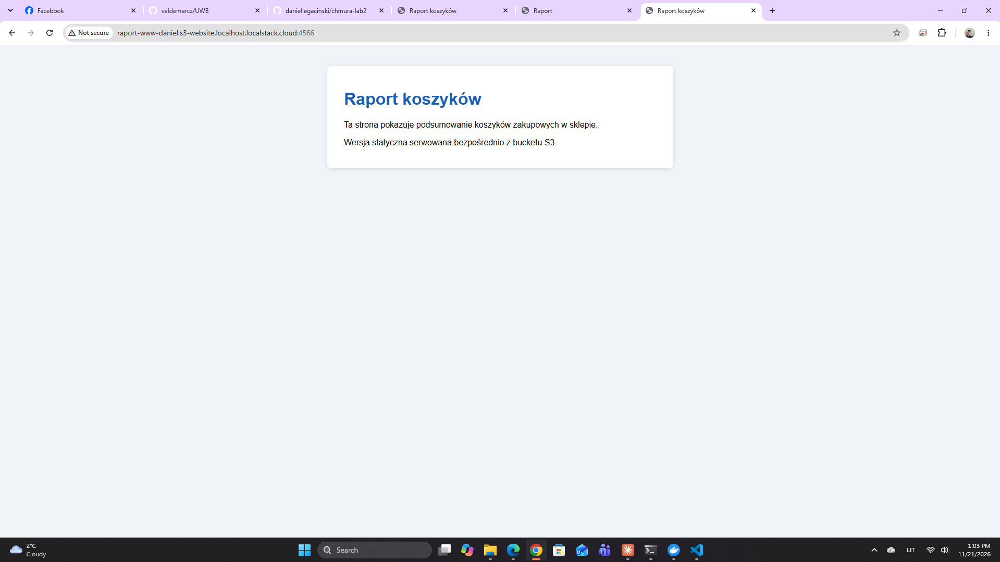
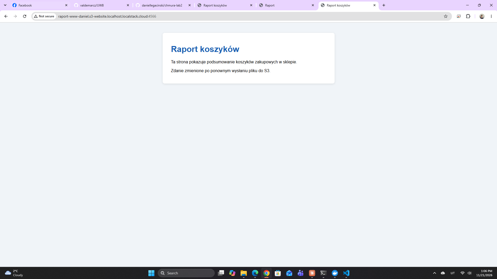
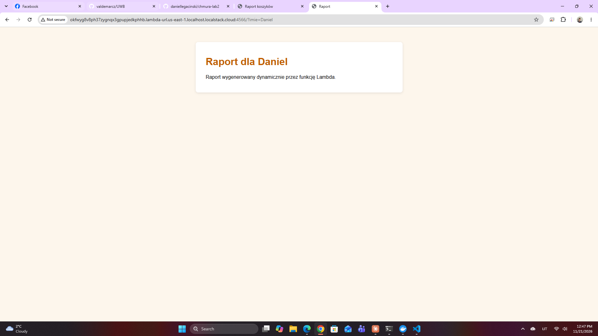
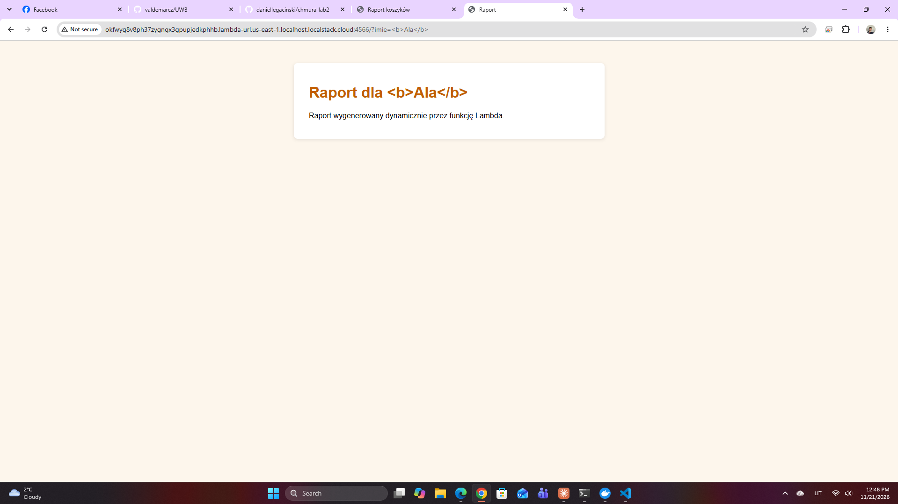
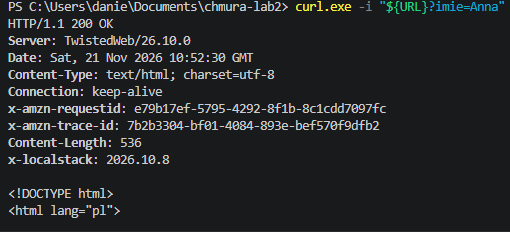
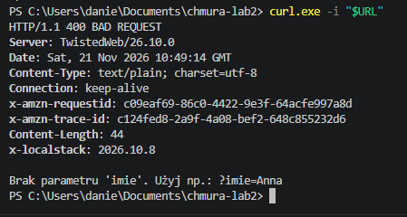
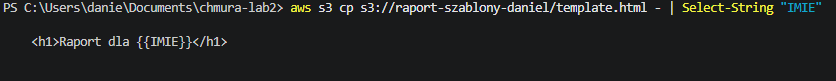

# Lab 2 – Jedna strona, dwa sposoby udostępnienia

**Autor:** Daniel Legačinski
**Środowisko:** LocalStack 2026.10.8 (Docker Compose), AWS CLI 2.42.1, Windows 11

## Zasoby

| Zasób | Nazwa |
|---|---|
| Bucket ze stroną statyczną | `raport-www-daniel` |
| Bucket z szablonem | `raport-szablony-daniel` |
| Funkcja Lambda | `raport-imie` (Python 3.12) |
| Function URL | `http://okfwyg8v8ph37zygnqx3gpupjedkphhb.lambda-url.us-east-1.localhost.localstack.cloud:4566/` |

## 1. LocalStack

```powershell
docker compose up -d
curl.exe http://localhost:4566/_localstack/health
aws configure set aws_access_key_id test
aws configure set aws_secret_access_key test
aws configure set region us-east-1
aws configure set endpoint_url http://localhost:4566
aws sts get-caller-identity
```

Port 4566 jest wystawiony tylko na `127.0.0.1`. Token LocalStack jest w pliku `.env`, który jest w `.gitignore`.

## 2. Strona statyczna w S3

```powershell
aws s3 mb s3://raport-www-daniel
aws s3 cp www/ s3://raport-www-daniel/ --recursive
aws s3 website s3://raport-www-daniel/ --index-document index.html
aws s3api put-public-access-block --bucket raport-www-daniel --public-access-block-configuration "BlockPublicAcls=false,IgnorePublicAcls=false,BlockPublicPolicy=false,RestrictPublicBuckets=false"
aws s3api put-bucket-policy --bucket raport-www-daniel --policy file://bucket-policy.json
```

Adres: `http://raport-www-daniel.s3-website.localhost.localstack.cloud:4566/`

Przed zmianą:



Po zmianie zdania i ponownym wysłaniu `index.html`:

```powershell
aws s3 cp www/index.html s3://raport-www-daniel/index.html
```



## 3. Lambda z szablonem z S3

```powershell
aws s3 mb s3://raport-szablony-daniel
aws s3 cp template.html s3://raport-szablony-daniel/template.html
Compress-Archive -Path lambda\handler.py -DestinationPath function.zip -Force
aws lambda create-function --function-name raport-imie --runtime python3.12 --handler handler.handler --zip-file fileb://function.zip --role arn:aws:iam::000000000000:role/lambda-role --environment "Variables={TEMPLATE_BUCKET=raport-szablony-daniel,TEMPLATE_KEY=template.html}"
aws lambda wait function-active-v2 --function-name raport-imie
aws lambda create-function-url-config --function-name raport-imie --auth-type NONE
```

### Dwa imiona




### Znaki specjalne (`?imie=<b>Ala</b>`)



### Odpowiedzi HTTP 200 i 400




### Zmiana szablonu w S3 bez ponownego wdrożenia funkcji

```powershell
aws s3 cp template.html s3://raport-szablony-daniel/template.html
```


### `{{IMIE}}` nadal w obiekcie w S3

```powershell
aws s3 cp s3://raport-szablony-daniel/template.html - | Select-String "IMIE"
```



## 4. Wnioski

## 4. Wnioski

**Kto tworzy HTML w każdym wariancie?**
S3 Website: HTML napisałem ja, wcześniej, a S3 tylko wysyła gotowy plik, bez zmian, każdemu tak samo.
Lambda: w S3 jest tylko szablon z {{IMIE}}. Gotowy HTML powstaje dopiero w chwili zapytania: składa go funkcja Lambda, czyli kod, z szablonu i parametru imie.

**Kiedy wystarczy strona statyczna?**
Gdy treść jest taka sama dla każdego odwiedzającego, np. strona informacyjna, wizytówka czy dokumentacja.
Plusy: prostsza, tańsza, szybsza, nie uruchamia żadnego kodu, mniej rzeczy może się zepsuć.
Lambda jest potrzebna dopiero wtedy, gdy strona ma zależeć od danych z zapytania, np. od imienia.

**Dlaczego szablon jest oddzielony od kodu?**
Test 4 pokazał, że wygląd strony można zmienić, wysyłając nowy szablon do S3, bez ponownego wdrażania funkcji.
Wygląd, czyli HTML, i logika, czyli Python, to osobne rzeczy. Szablon może zmieniać np. grafik, który nie zna Pythona.
Gdyby HTML był wpisany w handler.py, każda poprawka tekstu wymagałaby nowej paczki function.zip i ponownego wdrożenia.